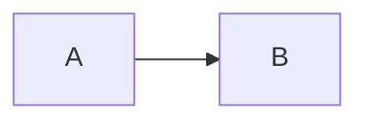

# Conversation export as OKF, and per-block copy

Status: SPECIFICATION, not built. No code changes accompany this document.
Written: 2026-10-14. Requested by: the operator, in chat.
Recommended delivery: a new top-level KBD phase, `chat-export-and-block-copy` (section 12).

## 1. Why

A visitor learns things in a conversation: the answers, the sources, the code, the diagrams. Today they can copy one message's text (the assistant-ui "Copy" action copies text parts only) or export one message as `message-<timestamp>.md` (also text only). Nothing exports a conversation, nothing exports the sources, and a diagram or code block can only be copied where a block already has its own button.

The operator wants two things:

1. **Export** a conversation, or all of them, as Open Knowledge Format (OKF) documents the visitor can keep and upload to a knowledge base.
2. **Per-block copy**: a Copy button on each code block, Mermaid diagram, SVG diagram, image, video and similar block, copying just that block, with the export accounting for those blocks too.

A third requirement came with the first: **the export runs entirely in the visitor's browser, and the product says so.**

A note on the name: the format is **Open Knowledge Format** (OKF), version 0.2, specified at `github.com/GoogleCloudPlatform/knowledge-catalog/okf/SPEC.md` (read 2026-10-14). The request said "Framework"; this document uses the spec's own name.

## 2. Requirements

### 2.1 Privacy (binding)

- **P-1. Client-side only.** Export builds the files from data already in the browser (PGlite on IndexedDB) and hands them to the visitor with a Blob download. It makes no network request carrying conversation content, calls no server, no model and no third-party service, and sends no analytics event that contains or describes content. A zip library, if needed, is code shipped in the app bundle (loaded lazily), not a service.
- **P-2. Say so.** The export control states, at the point of use, that the file is made in this browser and is not uploaded. The wording needs the chief content officer's pre-review and the operator's approval (section 9.2 has a draft). It must not claim more than the product does: the conversation was already sent to a cloud model to be answered, and the file, once downloaded, is the visitor's to protect.
- **P-3. Prove it.** A test asserts zero network requests during export (section 11). Without it, P-2 is a promise nobody checked.
- **P-4. Nothing internal in the file.** The export contains what the visitor sees, not what the app stores. Exclusions are in section 6.1.
- **P-5. No new storage.** Export writes nothing to IndexedDB, localStorage or a cookie.

### 2.2 Export

- **E-1. Current conversation:** one `.md` file, a single OKF concept document.
- **E-2. All conversations:** one `.zip`, an OKF bundle with one concept document per conversation, a root `index.md` and a `log.md`.
- **E-3.** Both are offered from the UI the visitor already uses, on the site build and on the app build.
- **E-4.** Output is valid OKF v0.2 (section 5) and also passes this repo's stricter parser (`scripts/kb/lib/frontmatter.mjs`), so a bundle can be dropped into a knowledge base or into this project's own `docs/knowledge-source/` tooling without edits.

### 2.3 Blocks and copy

- **B-1.** Every block type in section 7 has a Copy button that copies only that block, in the form listed there.
- **B-2.** The export represents each block type faithfully, or states plainly that it was left out (section 6).
- **B-3.** Copy and export share one definition of "the text of this block" so they cannot drift.

## 3. Current state (read from `origin/main`, 2026-10-14)

- **Storage.** Threads and messages live in PGlite at `idb://charcoal-db`: `threads(id, title, session_id, is_ephemeral, created_at, updated_at, ...)` and `messages(id, thread_id, role, content JSONB, created_at, status)`. `content` is the whole `ContentBlock[]` (`src/types/chat-content.ts`: `text`, `reasoning`, `tool-call`, `citation`, `skill-activation`, `context-update`, `image`, `error`, `memory-recall`, `memory-mutation`, `artifact`, `step`). `CharcoalDb.getThreads()` and `getMessages(threadId)` read them; the sidebar shows only non-ephemeral threads.
- **Existing export.** assistant-ui's `ActionBarPrimitive.ExportMarkdown` is in the "More actions" menu (`enhanced-thread.tsx` ~708). It exports `getCopyText()` of one message: text only. There is no zip library in `package.json`.
- **Rendering.** `enhanced-markdown-text.tsx` routes fenced code: `mermaid` to `MermaidBlock`; `html`/`svg` over 100 characters and `tsx`/`jsx` over 200 to `HtmlArtifactCard`; the rest to `ShikiCodeBlock`. Copy buttons exist on `ShikiCodeBlock`, `MermaidBlock` (copies the source), `HtmlArtifactCard` and `ArtifactBlock`, each written separately.
- **Gaps.** The sanitizer (`markdown-sanitize-schema.ts`, GitHub default schema) strips inline `svg`, `video`, `audio` and `iframe`. A short SVG (100 characters or fewer) renders as plain code. Images in replies load only from `know-me.tools` or a same-origin path (reply content policy, CSP `img-src 'self' data: blob:`). The `image` content block is skipped when rendering. Tables have no copy action. There is no `media-src` in the CSP, so `default-src 'self'` applies to video.
- **No dropdown-menu primitive** exists in `src/components/ui/`; the one menu is assistant-ui's `ActionBarMorePrimitive`.

## 4. Product design

### 4.1 Where the controls go

| Control | Placement | Action |
|---|---|---|
| **Export** (icon button, labelled "Export") | Top bar, shown on thread pages (site and app), beside the theme and About toggles | Opens a small menu: "This conversation (.md)", "All conversations (.zip)". |
| Export all | Sidebar footer, one text button | Same as the menu's second item. A visitor with no thread open can still export. |
| Per-message export | The existing "Export as Markdown" item in the message "More actions" menu | Keep, relabel "Export this message (.md)", and make it use the same serializer for one message (so it gains sources and blocks). |
| Block Copy | In each block's header row (code, Mermaid, SVG, table, image, video, card) | Copies that block only (section 7). |

The menu uses a new shadcn dropdown (Base UI), added through the project's shadcn config. Below 768 px every target is 44 px, like the web-search toggle.

The privacy line sits inside the menu, above the two items, always visible, not in a tooltip (touch has no hover).

### 4.2 Behaviour

- Single export is immediate (one thread, small). "All conversations" shows a progress state when there are many threads and a toast on completion ("Downloaded N conversations"). If there is nothing to export the item is disabled with the reason as visible text.
- Ephemeral threads and threads with no complete message are skipped. A message with `status: failed` or `in_progress` is exported as far as it got, followed by the line `_(this reply was incomplete)_`.
- Filenames: single `knowme-<slug>-<yyyymmdd>.md`; zip `knowme-conversations-<yyyymmdd>.zip`. Slug from the thread title, NFC-normalized, lowercased, limited to `[a-z0-9-]`, at most 48 characters, never a Windows reserved name, never empty (fallback `conversation`). Duplicates inside the zip get `-2`, `-3`.
- The download is a Blob URL and an anchor click, revoked afterwards. iOS Safari opens or saves it as the browser decides; the test plan names Safari.

## 5. The OKF documents

### 5.1 One conversation (concept document)

```markdown
---
type: Conversation
title: "Rust release question"
description: "What is the latest stable Rust release? Answered with web sources."
status: stable
generated:
  by: knowme-site/1
  at: "2026-10-14T05:12:03+00:00"
tags: [conversation, knowme]
sources:
  - id: W1
    resource: https://blog.rust-lang.org/releases/latest/
    title: Announcing Rust 1.99.0
  - id: K1
    resource: "KnowMe knowledge base: faq"
    title: FAQ
---
# Rust release question

Conversation with the KnowMe concierge, 2026-10-14 04:55 to 05:12 UTC.
Exported from know-me.tools in the browser. This file was not uploaded anywhere.

## You

What is the latest stable Rust release?

## KnowMe concierge

The latest stable Rust release is 1.99.0.[^W1]



[^W1]: Announcing Rust 1.99.0, https://blog.rust-lang.org/releases/latest/
```

Rules:

- **Frontmatter uses only keys OKF defines or this repo's profile allows** (`type`, `title`, `description`, `status`, `generated`, `tags`, `sources`, `resource`): no extension keys, no comments, two-space indent, quoted timestamps. That keeps it inside the strict subset `scripts/kb/lib/frontmatter.mjs` parses. Times of the conversation go in the body, not in extra keys.
- `type: Conversation`. OKF consumers must tolerate unknown types, so this is safe, but nothing guarantees a given knowledge base indexes it well (section 13).
- `generated.by` is the product and a format version, `knowme-site/<n>` or `knowme-app/<n>`; `generated.at` is the export time. No `verified`: nobody confirmed this content.
- `description` is the first question, truncated to one sentence of at most 160 characters. No model call: P-1.
- **Sources and footnotes.** Web citations get ids `W1`..; knowledge-base citations get `K1`... The reply markers `[W1]`, `[1]` become footnote references `[^W1]`, `[^K1]` (OKF 5.1: the footnote label is the `sources[].id`). A `sources` entry needs a `resource`: a web source uses its server-minted https URL; a KB source has no public URL, so it uses a scope descriptor (`KnowMe knowledge base: <file stem>`), which OKF 5.1 allows. A footnote definition is added once per source, at the end of the message that cited it, with the title and URL as text. No snippet is exported for web sources (none is stored: operator decision of 2026-10-13).
- Message headings are `## You` and `## KnowMe concierge`. No user name, no account, no device id.
- The conversation `id` and `session_id` are not exported (P-4). Where a stable name is needed, use the first eight hex characters of a SHA-256 of the thread id: not reversible, enough to avoid file collisions.

### 5.2 All conversations (bundle)

```
knowme-conversations-20261014.zip
  index.md                              # okf_version: "0.2"; lists conversations newest first
  log.md                                # one entry per export run, "Initialization" with the count
  conversations/
    2026-10-14-rust-release-question-3fa9c1d2.md
    ...
```

- Root `index.md` carries only `okf_version: "0.2"` in its frontmatter (OKF 8 and 12) and bullets `* [Title](/conversations/<file>.md) - description`, newest first, grouped by month.
- `conversations/index.md` is not needed; one root index is enough.
- `log.md` follows OKF 9: a `## <date>` heading and one `**Creation**` line.
- Links inside the bundle are absolute bundle paths (`/conversations/...`), as OKF recommends.
- The zip holds no files other than these. No `assets/` in the first release (section 7.3).

## 6. What the export contains

### 6.1 Excluded, always (P-4)

Reasoning text; tool calls (name, arguments, result, ids); subagent paths; memory recall and memory mutation content and ids; skill activation and context-update details; run, artifact, session and thread ids; agent id and name; `isEphemeral`; the hidden artifact types (`provider_event`, `attempt_manifest`, `effective_run_policy`, `turn_manifest`); `error` blocks (the UI shows a fixed line, and so does the export, as `_(this reply stopped before it finished)_`). Steps ("Searching the web") are not exported; if a message has web citations, the line `_Web search was on for this answer._` is added instead.

On the site build most of these never reach the browser (the public stream filter drops them). On the app build they can be stored, which is why the serializer allowlists block types instead of excluding a few.

### 6.2 Included

User and assistant text, as stored markdown. Citations as section 5.1. Artifacts and rich blocks as section 7. Message times as one italic line under each heading, ISO 8601 with offset.

### 6.3 Allowlist, not denylist

The serializer maps each known block type to output and **drops any unknown type**. A new block type added later is therefore excluded until someone decides how to export it, never leaked by default. A test enumerates `ContentBlock['type']` and fails when a type has no mapping (section 11).

## 7. Block types: copy and export

All blocks use one `CopyButton` component and one `useCopyToClipboard` hook, replacing the three hand-written copies in `ShikiCodeBlock`, `MermaidBlock` and `HtmlArtifactCard`/`ArtifactBlock`.

| Block | Copy button copies | Export representation |
|---|---|---|
| Fenced code (Shiki) | the code, no language label, no line numbers | fenced block with its language tag |
| Mermaid | the Mermaid source | a ```` ```mermaid ```` fence (source is the canonical form; the SVG is not persisted) |
| SVG | the SVG source | a ```` ```svg ```` fence |
| HTML / TSX artifact | the source | fence with `html` / `tsx` |
| Table | the table as GitHub markdown (a second action "as TSV" is optional) | the markdown table as stored |
| Math (KaTeX) | the TeX source | `$...$` / `$$...$$` as stored |
| Image | the image, as PNG on the clipboard where the browser allows `ClipboardItem`; otherwise the image URL | `` for an own-host or same-origin image, converted to an absolute `https://know-me.tools/...` URL; any other image is omitted as the reply policy already omits it |
| Video | the video URL | `[Video: <title or host>](<url>)`, never embedded |
| A2UI card | the card's text: title, summary, source, and the fixed AI caption | the same text as a blockquote, including the caption "AI-generated · check important details", so a model-written card is still labelled once it leaves the app |
| Citation / source row | the source title and URL | a footnote definition |

Copy behaviour for every block:

- A button in the block header, `aria-label` names the block ("Copy code", "Copy diagram source", "Copy table", ...).
- Success: icon changes to a check and a polite live region announces "Copied"; resets after 2.5 s. Failure (permission denied, insecure context): the label changes to "Couldn't copy" and the block text is selected so the visitor can press the shortcut. No silent failure.
- 44 px target below 768 px, 32 px from 768. No colour-only state. Honours reduced motion. Keyboard: reachable in order, Enter and Space activate.
- The button copies the block's data, not the rendered DOM text (a highlighted code block has spans; the copy must be the raw string).

### 7.1 Rendering support this needs (the gaps in section 3)

- **SVG.** A fenced ```` ```svg ```` block gets its own `SvgBlock` (not `HtmlArtifactCard`, and not code for short ones): Preview and Source toggle, Copy source, Download `.svg`. Preview renders the SVG through `` (or a Blob URL). An SVG shown by `` cannot run scripts or load external resources, so no sanitizer for SVG is needed and the CSP (`img-src data: blob:`) already allows it. Size cap (for example 256 KB); over the cap shows source only.
- **Image.** Keep the own-host-only rule. Decide separately whether the `image` content block (skipped today) should render; the export follows whatever the renderer does.
- **Video.** Allow `<video controls preload="none">` with `<source>` only for the own host. Remote video is **not** allowed: loading it sends the visitor's IP address and referrer to a third party the moment it renders, the same reason remote images are refused. This needs sanitizer and reply-policy changes and a `media-src 'self'` decision in the CSP. If video is not wanted at all, the link form in the table above is the whole feature.
- **Tables.** Add the copy action to the existing table wrapper.

This is a security-relevant change to the reply allowlist and needs the security officer's review before merge (section 12).

### 7.2 Mermaid and the diagram image question

The export keeps Mermaid as source. A rendered SVG (or PNG) of each diagram inside the zip would help knowledge bases that do not render Mermaid, but it needs a re-render at export time (Mermaid is lazy-loaded, `securityLevel: "strict"`) and an `assets/` directory. Defer to a second release; the first release's Mermaid fence is lossless and reproducible.

### 7.3 Images in the zip

Own-host images are exported as absolute URLs, not embedded: fetching them would be a network request, even to our own origin, and P-1 is easier to prove if export makes none. Embedding images the browser already holds (data or blob URLs from attachments) is possible but out of scope for the first release.

## 8. Technical approach

- **Source of truth:** read `getThreads()` and `getMessages(threadId)` straight from PGlite, not from the in-memory chat store, which may hold a partly hydrated thread.
- **Module layout** (feature-based, UI then hook then service): `src/features/export/` with `serialize-message.ts` (block to markdown, pure), `serialize-thread.ts` (frontmatter, sources, footnotes), `build-bundle.ts` (index, log, filenames), `download.ts` (Blob and anchor), `use-export.ts` (hook), and the menu component. The serializer is pure and takes plain data, so it is unit-testable without a browser.
- **Zip:** a small zip writer loaded with a dynamic `import()` so it costs the landing and thread chunks nothing. Candidate: `fflate`. Verify the current version, size and licence from the registry before adding it (AGENTS.md: do not rely on remembered versions). Writing the zip format by hand is also possible for stored (uncompressed) entries and removes the dependency; the plan should compare the two. For hundreds of threads, build the zip in a Web Worker or in chunks so the page does not freeze.
- **Frontmatter writer:** a tiny serializer that quotes every string and timestamp; do not add a YAML library. A titled thread containing `:`, `#`, quotes, newlines or leading `-` must round-trip (test).
- **Shared block text:** `blockText(block)` is the single function that both Copy buttons and the serializer call.
- **Bundle budget:** export code is lazy; the always-loaded cost is the menu button only.

## 9. Content and copy

### 9.1 Wording rules

No claim stronger than the product backs. The product stores conversations in this browser and sends messages to a cloud model to answer. Do not write "private", "secure", "never leaves your device" or any compliance word. Do say what the export does.

### 9.2 Draft strings (DRAFT, pending content-officer review and operator approval)

- Menu privacy line: "Made in this browser. Nothing is uploaded."
- Menu items: "This conversation (.md)", "All conversations (.zip)".
- Menu note, one line: "The file holds everything said in the conversation. Keep it somewhere you trust."
- Toast: "Downloaded {n} conversations."
- Disabled item reason: "No conversations to export yet."
- Block copy labels: "Copy code", "Copy diagram source", "Copy SVG source", "Copy table", "Copy image", "Copy video link", "Copy card text"; state text "Copied", "Couldn't copy".

All visitor-facing strings go in one file under `content/site/` (as `web-search.ts` does) so approval means editing one file, with a review record under `docs/content/reviews/`.

## 10. Security and abuse considerations

- **The file carries what the visitor typed.** That is the point, and also the risk: a shared computer, a synced downloads folder, or an upload to a third-party knowledge base can expose it. The menu note says so once, plainly.
- **Injection into the file.** Assistant text is model output and may contain markdown, links or front-matter-like lines. It sits in the body below the frontmatter, and the serializer never builds frontmatter from message text (title and description are escaped; a title containing `---` cannot close the block). A test feeds hostile titles and bodies.
- **Links.** Web source URLs in the export are the server-minted https URLs. Reply links that the on-screen policy would have rendered as text (with the destination shown) are exported as text with the destination, not as live links, so an export cannot become a stronger link surface than the page.
- **SVG and video** changes widen the reply allowlist and need the security review described in section 12.
- **No telemetry on content.** If export usage is counted at all, it is a count of clicks with no content and no thread data, decided separately.

## 11. Verification (acceptance)

Evidence the phase must produce at its integration boundary, not per edit:

1. **Serializer golden files**, one per block type and one per exclusion class, run through a real PGlite fixture (the repo has `write-queue.real-pglite.test.ts` as a pattern).
2. **Completeness test:** every `ContentBlock['type']` has a mapping or an explicit exclusion. Adding a type without one fails the test.
3. **Leak test with a mutation check:** a fixture message containing reasoning text, tool args, memory items, internal ids, hidden artifact types and a canary string in each; assert none appears in the output; then break the serializer's allowlist and confirm the test fails (the project rule: a security assertion is not evidence until it fails on the bug).
4. **OKF validity:** every generated file parses with `scripts/kb/lib/frontmatter.mjs`; the bundle has `type` on every concept, `okf_version: "0.2"` on the root index only, and valid ISO 8601 offsets. Round-trip hostile titles.
5. **Zip integrity:** unzip the output in the test and compare entry names and contents; check filenames for collisions, reserved names and path traversal characters.
6. **Privacy proof (P-3):** a Playwright test starts an export of one thread and of all threads and asserts that no network request is made between the click and the download (request interception, zero matches).
7. **Playwright download tests:** the `download` event fires with the expected filename and the file contains the expected text.
8. **Copy buttons:** per block type, grant clipboard permission, click, read the clipboard, compare to `blockText`; a denied-permission case shows "Couldn't copy".
9. **Accessibility:** axe scan of the menu and a block with its button, keyboard-only path, reduced-motion check, contrast of the new states.
10. **Visual:** screenshots at 320 and 1440, both themes, of the menu, a code block, a Mermaid block, an SVG block and a table with copy buttons; looked at, not just captured.
11. **Browser coverage:** Chrome, Firefox and Safari for the download and clipboard paths; iOS Safari for download behaviour.
12. **Bundle:** the always-loaded JS delta is the menu only; the export chunk loads on first use.

What would remain unverified and must be said in the PR: behaviour of every third-party knowledge base on `type: Conversation`; very large exports (record the largest tested thread count).

## 12. Recommendation: what kind of phase

**A new top-level KBD phase named `chat-export-and-block-copy`, with its own full lifecycle (assess, plan, execute, reflect). Not a child phase, and not an extra change inside `site-chat-hardening-and-polish`.**

Reasons:

1. **The parent is not finished and its ledger has drifted.** `site-chat-hardening-and-polish` is active at 1 of 15 changes in its ledger while the code on `main` is well ahead of it (web search, clickable citations and the landing toggle all shipped outside that ledger). Hanging a feature under it would inherit a stale position record.
2. **A child phase fits a bounded sub-piece that inherits the parent's constraints and hands back.** The one child in this repo, `uar-capability-assessment`, was a read-only assessment with a write scope. This work is a product feature with its own goals, design decisions, a security review and a deploy, and the parent's standing constraints ("no deploy unless a change must reach the cluster; interim PRs `[skip ci]`") are wrong for it: it must deploy.
3. **It is not just an OpenSpec change.** It adds a dependency, widens the reply allowlist (security officer review), adds visitor-facing copy (content officer review and operator approval) and a privacy claim that needs a test to be true. That is a phase's worth of gates.
4. **It is two deliverables with an order.** Per-block copy and media blocks stand alone and ship first; the OKF serializer builds on the block taxonomy they settle.

Proposed changes inside the phase, in order:

1. `app-block-copy-and-media-blocks`: the shared `CopyButton`, copy on every block, `SvgBlock`, table copy, the video and image decisions, sanitizer and CSP changes, security review. Ships on its own.
2. `app-chat-export-okf-single`: the pure serializer, the allowlist, the OKF single-document download from the top bar, privacy line and tests 1 to 7 above for one conversation.
3. `app-chat-export-okf-bundle`: the zip writer, `index.md`, `log.md`, "Export all", progress for large counts, the remaining tests.

Roles: km-product-owner (acceptance criteria), km-frontend-engineer (UI, serializer), km-security-officer (allowlist widening, injection tests, the privacy-claim test), km-chief-content-officer (strings), km-qa-engineer (a11y, downloads, browsers), km-conversational-designer is not needed. The Impeccable design context applies to the menu and the block headers.

Entry preconditions: the operator decides whether to park `site-chat-hardening-and-polish` (so the waypoint can move) or run both; the waypoint, `project.json` and `current-waypoint.md` already disagree about the active phase and are best reconciled first, as a separate piece of housekeeping.

Delivery: each change ships as a ready PR to `main`. These are client changes, so merging deploys `knowme-web` to production with no approval stop; change 1 must have its security review recorded before merge.

## 13. Open decisions for the operator

1. **Reasoning and tool details:** the default excludes them (section 6.1). Confirm. An "include reasoning" switch is not recommended: the site filter deliberately never shows reasoning to visitors.
2. **Video:** own-host only, or links only, or none? (Section 7.1.)
3. **Diagram images in the zip** (Mermaid and SVG rendered): first release or later? Recommended later.
4. **Per-turn concepts:** one concept per conversation is specified, because the request was "separate OKF documents" per conversation. A concept per question-and-answer pair would index better in a knowledge base but breaks a conversation across files.
5. **Zip dependency:** adopt a small library or write the stored-entry zip format by hand.
6. **App build parity:** export on both builds is specified; the app build's richer stored blocks make the allowlist matter more.
7. **Privacy and menu wording** (section 9.2): content-officer review and operator approval.
8. **Export usage counting:** none, or a bare click count.

## 14. The uncomfortable part

"Client-side" makes the export private, not the conversation. The visitor's messages were sent to a cloud language model to be answered, and the product must not let the export button imply otherwise. The privacy line is limited to what is true: the file is made here and not uploaded. A test makes that sentence checkable, and without that test the line should not ship.

The second risk is that OKF consumers are tolerant by design (unknown `type` values are accepted), so a `Conversation` bundle will load almost anywhere and still retrieve badly: dialogue is a poor retrieval unit, and nothing in the format fixes that. The export gives a visitor a faithful, well-formed record. Whether a given knowledge base makes good use of it is outside this product.

## 15. Amendment 2026-10-15: mobile save flow and stream reliability

This section records what was built and what production showed, so the next change (the zip bundle) starts from facts.

### 15.1 Mobile save flow as built (change `app-chat-export-okf-single`, PR #110)

- The file is built when the Export menu opens, from the in-memory chat snapshot, not from PGlite. Building at open must be synchronous, and the database write queue can lag right after a reply. iOS Safari drops the user gesture after an `await`, so the tap that saves must start the share or download call before any `await`.
- Save order: `navigator.share({files})` when `navigator.canShare({files})` accepts the file; otherwise an anchor download with a Blob URL revoked after 60 s; otherwise a read-only, select-all text area in a dialog. "Copy as Markdown" is a separate action. A cancelled share (`AbortError`) is silent.
- Below 768 px the menu is a bottom sheet with 44 px targets. The trigger stays enabled while the actions are disabled, so the reason can be read on touch.
- Privacy proof: a Playwright test records every request from just before the click to the end of the save, share or copy and asserts none. A mutation check (a `fetch` added to the save handler) makes it fail.
- Not verified at the time of writing: a real iOS share sheet, Android, WebKit and Firefox. Task 4.8 holds these, and the operator records the device results.
- The bundle (change 5) must not reuse the build-at-open rule for a large zip. Build it in two steps, Prepare then Save, on touch devices.

### 15.2 Stream reliability findings (changes 1 and 3, and production, 2026-10-14 and 15)

- Client work shipped in PR #103: text deltas are coalesced to one store commit per animation frame (50 ms while the page is hidden), message conversion is memoized per message, markdown during streaming is throttled with an unclosed-fence gate, auto-scroll is no longer smooth, and a blocked IndexedDB delete rejects after 3 s instead of hanging.
- Production finding: replies were ending with "The reply stopped before it finished." about 62 s after the request, with no text and no error line in the UAR logs. Cause, read from the UAR source: `llm.timeout_secs` defaults to 60 and is a total deadline that also cuts a stream still producing output. Setting `UAR_LLM__TIMEOUT_SECS=240` (PR #111) did not change it for the site agents, because per-provider resolution in `ProviderRegistry::resolve_to_llm_config` builds its config from `LlmConfig::default()`, so the timeout reverts to 60 s per model call. A fix in UAR is in progress.
- Consequence for export: a reply cut by this timeout is stored as a failed message. The serializer marks it "stopped" and still exports the text received.
- Consequence for resume (change 2, `site-stream-resume`): the decision gate there should consider this server-side cause before the iOS page-hidden cause. A resume path does not help a stream the server itself ends at 60 s.
